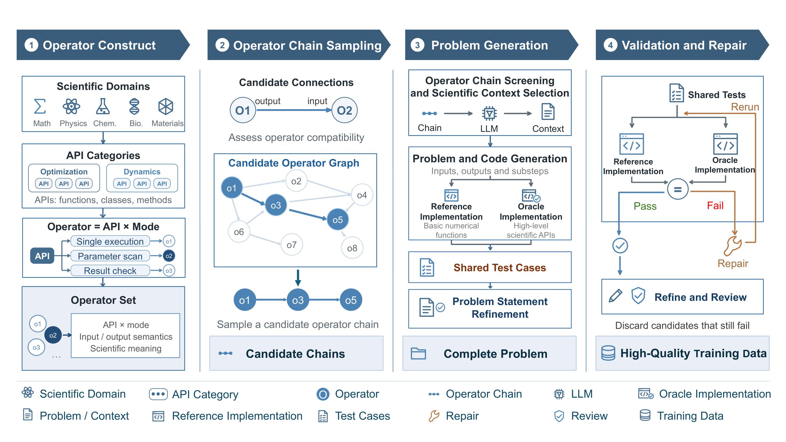
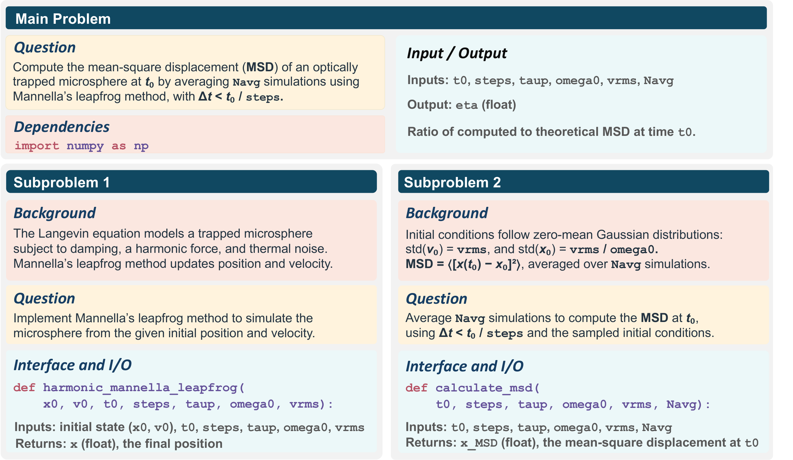

# SciWalker

**Synthesizing Scientific Coding Problems with Operator Graphs and Execution Feedback**

[](LICENSE)
[](https://arxiv.org/abs/2609.30054)

SciWalker generates scientific coding problems from API operator graphs through LLM generation, execution-guided repair, and quality review.



*The framework overview from the SciWalker paper.*

## Quick start

### 1. Install

Prerequisite: a standalone CPython 3.10 installation (`python3.10`).

```bash
git clone https://github.com/lichenx1/SciWalker.git
cd SciWalker
python3.10 -m venv .venv
source .venv/bin/activate
```

Install the framework and scientific dependencies:

```bash
python -m pip install -r requirements/example-py310.lock.txt
python -m pip install --no-deps -e .
python -m pip check
```

### 2. Connect an LLM service

```bash
cp configs/pipeline.example.json configs/pipeline.local.json
cp configs/llm.example.json configs/llm.local.json
```

Edit `configs/llm.local.json`:

| Field | What to set |
| --- | --- |
| `base_url` | API prefix, e.g. `http://127.0.0.1:8000/v1`; the client appends `/chat/completions`. |
| `model` | Your endpoint's model identifier. |
| `api_key` | Your service's API key. |
| `max_tokens` | Maximum response-token budget. |

### 3. Check and run

```bash
python -m scidata.workflow check
bash scripts/run_all.sh
```

## Run the three phases separately

Alternatively, run the phases individually with the same local configuration:

```bash
bash scripts/01_prepare.sh
bash scripts/02_generate.sh
bash scripts/03_export.sh
```

Preparation checks APIs and saves graphs and chains without LLM calls. Generation constructs, repairs, and reviews problems; export writes Parquet. All phases use the active Python environment by default.

Intermediate files are under `catalog/`, `chains/`, and `generation/` in the run directory; logs are under `logs/` and `stage_manifests/`. Continue from a completed phase, but use a new run directory after an interrupted generation batch.

## Generated problems

Each problem includes a main task, dependent subproblems, scientific backgrounds, reference and oracle solutions, and executable tests.



*SciCode-style problem format illustrated in the paper.*

## Citation

```bibtex
@misc{li2026sciwalker,
  title={SciWalker: Synthesizing Scientific Coding Problems with Operator Graphs and Execution Feedback},
  author={Chenxi Li and Wenxuan Zeng and Yun Luo and Fangchen Yu and Peng Ye and Yu Cheng and Jun Zhang},
  year={2026},
  eprint={2609.30054},
  archivePrefix={arXiv},
  primaryClass={cs.AI},
  url={https://arxiv.org/abs/2609.30054}
}
```
